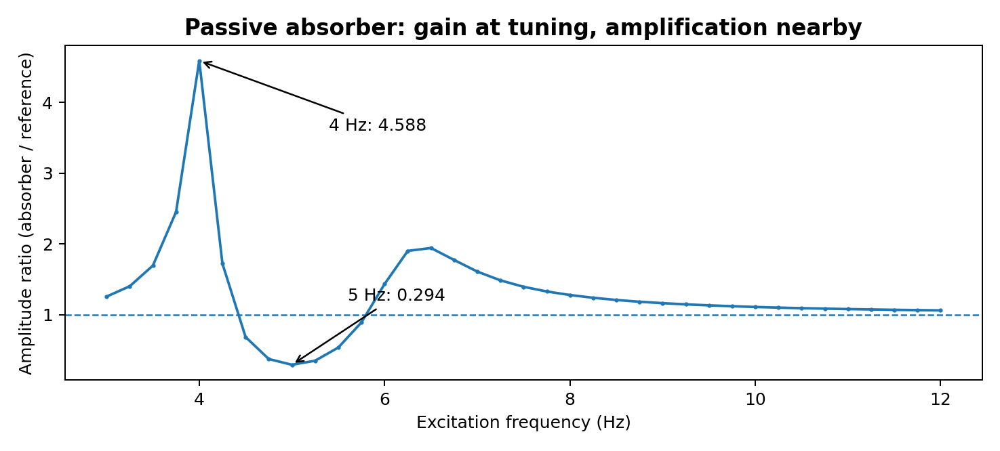

# A Mass Penalty Cannot Be Hidden in a Tremor-Control Score
## Negative feasibility note for a passive handheld tuned-mass concept

**Research note 0.1 — NOT a validated medical product or clinical trial**  
**November 17, 2026**
**Terrynce Anson White — Independent Researcher, OpenLine**  
**Manuscript: CC BY 4.0. Executable code: Apache License 2.0. Version 1.0.**

### Question

Should an approximately 180 g passive tuned-mass stabilizer be advanced as a separate handheld assistive tool on the strength of Argon's proposed 5 Hz attenuation? The decisive cost is the additional load and fatigue burden, coupled with a narrow-band response that might amplify other unwanted motion. The original seven-family screen ranked this as a distinct mechanical finalist but explicitly held it on weight.

### Minimal check, not human evidence

`src/tremor_feasibility.py` implements a highly simplified two-degree-of-freedom forced harmonic oscillator with a primary natural frequency of 5 Hz, a tuned absorber, mass ratio 0.2, and damping ratio 0.1. It compares the amplitude of the primary degree of freedom with and without the absorber. The force model and damping do not represent a person's hand, a real utensil, wrist dynamics, adaptive control, or measured tremor. The assumed mass ratio does not validate an absolute 180 g design.

Across 37 frequencies at 0.25 Hz steps from 3 to 12 Hz, this illustrative model reduces normalized response in 6 bins and increases it in **31 bins**. At 5 Hz the ratio is **0.294**; at 4 Hz it rises to **4.588**. An attractive center-frequency number is therefore not a broad-band safety or function claim. The model is a test of model fragility, not an estimate of patient benefit or harm.

### Prior art and decision

Passive tremor absorbers are already studied, including cantilever-based passive absorber research and biomechanical studies. The issue is not whether passive damping has ever worked: it is whether *this exact proposed mass, damping, grip, and user burden* improve a real task under a fair comparator. The current evidence does not justify constructing a human-use prototype or claiming novelty.

**Disposition: HOLD a physical build and do not issue this as a standalone breakthrough paper.** Preserve this negative result as an appendix to the portfolio, not as a failure of all tremor-control research. Next relevant evidence would be ethically supervised, independently instrumented, person-centered measurement using a safe fixture and a conventional utensil comparator. No hardware has been energized or tested in this study.

### Sources

- Argon seven-family screen, `OPENLINE_REALITY_GROUNDED_FRONTIER_INVENTION_001_PACKAGE.zip` (November 17, 2026).
- Review of mechanical tremor approaches: https://pmc.ncbi.nlm.nih.gov/articles/PMC11568799/
- *Design and Simulation of a Passive Absorber to Reduce Measured Postural Tremor Signal*: https://pubmed.ncbi.nlm.nih.gov/35237796/
- Reproducer: `src/tremor_feasibility.py`, `run_portfolio.py`.
