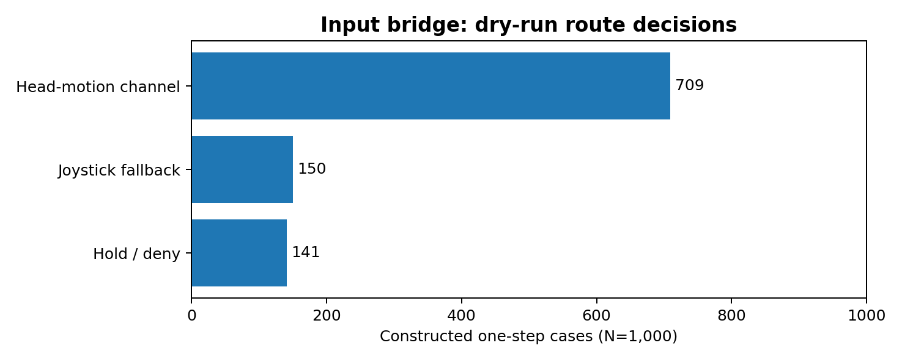

# Continuity Is the Capability
## A Fault-Aware, User-Controlled Input Bridge for Accessible Computer Interaction

**Working paper 0.1 — computational prototype, November 17, 2026**  
**OpenLine independent research — technical report, not peer reviewed**
**Terrynce Anson White — Independent Researcher, OpenLine**  
**Manuscript: CC BY 4.0. Executable code: Apache License 2.0. Version 1.0.**

### Abstract

Accessible computer input is not simply a matter of mapping a head motion or pneumatic pressure change to a cursor command. An operator may need to continue a drag through the loss of a sensor, reject an accidental action when a pressure reference drifts, and retain the power to stop the device immediately. We report a small, dependency-free *software state-machine prototype* that tests this narrower continuity problem. It takes timestamped head-motion, joystick, pneumatic, current, and explicit human control events; proposes dry-run HID events; and enforces fail-closed transitions for stale evidence, overcurrent, STOP, and ambiguous pneumatic measurements. On 1,000 deterministic, generated fault cases it preserved the predeclared no-unsafe-proposed-click invariant in 1,000/1,000 cases. It used a joystick fallback in 150 cases and held or denied movement in 141 cases. Twenty-seven portfolio unit tests passed, including tests for manual STOP, epoch-bound Resume, and snapshot-integrity detection. These are source-executed tests of a constructed protocol, **not sensor measurements, clinical trials, human usability outcomes, or evidence of superiority over commercial assistive controllers**. The work supplies an auditable starting point for supervised hardware and user testing.

### 1. The problem and its real predecessor

Input continuity matters when the user's primary channel becomes unreliable midway through an action. It must not be inferred merely because a classifier predicts intent with high confidence. A switch press or intentionally configured pneumatic gesture may request an effect, but authority and sensor validity remain distinct questions.

The underlying concept of low-cost head tracking combined with sip-and-puff is established prior art. Makers Making Change's LipSync is an open-source mouth-controlled computer interface. A 2025 paper, *A Low-Cost Head-Controlled and Sip-and-Puff Mouse: System Design and Preliminary Findings*, describes the same broad category of input. Accordingly, the present candidate makes **no claim to have invented head tracking, sip-and-puff input, USB HID, sensor fusion, or redundant input generally**. Its candidate contribution is an explicitly testable failover and authority protocol around those known elements.

The source material for this study is Argon's `OPENLINE_REALITY_GROUNDED_FRONTIER_INVENTION_001_PACKAGE.zip`, which estimated a $48.60 single-device components cost and a $66.10 five-year total cost. Those numbers are **unverified planning inputs** here. They do not include independently obtained current vendor quotes, assembly labor, assistive customization, validation, or regulatory costs.

### 2. Implemented protocol

The executable prototype `src/continuity_bridge.py` accepts a finite `InputFrame` and produces only a `DRY_RUN_PROPOSED_HID_ONLY` record. It does **not** move the local operating-system pointer. It supports head tracking when the head-motion channel is within its specified numerical envelope and fallback to an available joystick channel. Loss of both kinematic channels releases the simulated drag and holds movement.

A user-pressed STOP increments a local epoch, cancels movement, releases drag, and rejects all click requests. Resume requires the exact stopped epoch; a stale value fails. Sample time is monotonically checked and bounded by a 150 ms simulated staleness window. Above the configured overcurrent threshold, the software stops proposing motion or click. This is a logical guard, **not proof that an actual eFuse trips within any specified time**.

Pneumatic status is screened using a declared differential consistency threshold between a sense, ambient-reference, and witness channel. This is a software assumption, not a calibrated physical observability demonstration. No pneumatic signal triggers a click by default. In explicitly opt-in mode, a pressure-based command requires a sustained high-threshold dwell and witness consistency; a noisy or single-channel transition does not count as user authorization. The primary default click channel remains an explicit switch edge. All outputs remain dry-run until a separate, permissioned HID implementation is tested.

Snapshot SHA-256 detects accidental state modification but cannot authenticate a remote issuer because the producer controls its own snapshot. The snapshot is deliberately labeled *integrity only, not authenticity*. No cryptographic receipt or independent authority system is claimed for this standalone module.

### 3. Tests and observed computational results

The repository includes 27 unit tests across its portfolio, of which 13 exercise the input bridge. They cover primary control, mid-drag failover, missing channel hold, explicit click and click-edge behavior, pneumatic opt-in dwell, witness disagreement, STOP, stale Resume, overcurrent isolation, stale telemetry, and state snapshot corruption. The same 27-test suite passes under ordinary Python and Python `-O`.

A fixed-seed construction (`run_portfolio.py`, seed 20261117) generated 1,000 one-step cases with independent probabilistic faults and intentional user clicks. The test asserts a specific invariant: if STOP, overcurrent, witness drift, or loss of all motion channels is present, the proposed output must not contain a click. The result was 1,000/1,000 invariant passes; 709 cases used head control, 150 used joystick fallback, and 141 held or denied movement. Of the generated cases, 220 had witness drift, 73 exceeded the current threshold, and 52 asserted STOP; cases may overlap. Only 126 intentional, witness-consistent proposed clicks occurred.

These numbers are generated by the state machine and scenario generator themselves, so they should be read as **implementation regression evidence, not estimated real-world accident rates**. The single-step stochastic generator does not model long-term sensor drift, ergonomics, calibration failures, human learning, or adversarial timed input races. The 150 fallback events prove that a fallback branch was executed; they do not establish how quickly a person could recover an interrupted real-world drag.

### 4. Counterfactual and falsifiers

A fair comparator must include established affordable head tracking, LipSync-like input, assistive switches, calibration tools, and conventional failover at a matched bill of materials and labor budget. The inherited Argon 6.15x capability-per-dollar comparison to a commercial bundle, and its 1.86x comparison to an internally equalized conventional design, are **not independently re-established by this paper**. They are prior constructed-model hypotheses, not physical outcomes.

The first external falsifier is a blinded assisted-input task: the participant must complete pointer acquisition and drag operations across deliberately randomized, safe sensor dropouts, while an independent logger measures completion, unwanted actions, interruptions, recovery time, user fatigue, and device cost. The comparator receives the same acceptable sensor modalities and setup support. A useful candidate must improve task continuity *without increasing accidental commands or fatigue*; perfect abstention is not a victory. Any failure to allow the user to stop or resume reliably is a release blocker.

### 5. Limitations and publication standing

**Software state-machine prototype only.** No Pico firmware was compiled or installed; no circuit board, pressure tubing, eFuse, sensor array, or enclosure was assembled or measured. No USB HID was emitted. No users, clinicians, disability representatives, or accessibility testers were recruited or studied. The control protocol is not ready to be used as a safety-critical assistive device. Original Argon CAD/netlist/firmware files are retained separately as unverified references, not build-approved electrical instructions.

This report is suitable for release as a source-linked computational engineering note after authorship, licensing, and security checks. It is **not** a journal-quality accessibility efficacy paper until external hardware measurements and participatory user evaluation exist. A persistent identifier would make the version citable, not validate its claims.

### Sources and reproduction

- Original Argon candidate: `OPENLINE_REALITY_GROUNDED_FRONTIER_INVENTION_001_PACKAGE.zip` (November 17, 2026), preserved separately; not assumed independently certified.
- Makers Making Change, LipSync: https://github.com/makersmakingchange/LipSync
- *A Low-Cost Head-Controlled and Sip-and-Puff Mouse: System Design and Preliminary Findings* (2025): https://doi.org/10.3390/electronics14244953
- Raspberry Pi Pico official hardware documentation: https://www.raspberrypi.com/documentation/microcontrollers/pico-series.html
- Source, tests, and deterministic trials: `src/continuity_bridge.py`, `tests/test_prototypes.py`, `run_portfolio.py`, `results/constructed_scenario_receipt.json`.

Run `python3 -m unittest discover -s tests -v` and `python3 run_portfolio.py` from the bundle root. Both require only standard Python 3.10+ and no paid APIs, credentials, attached equipment, or network access.
