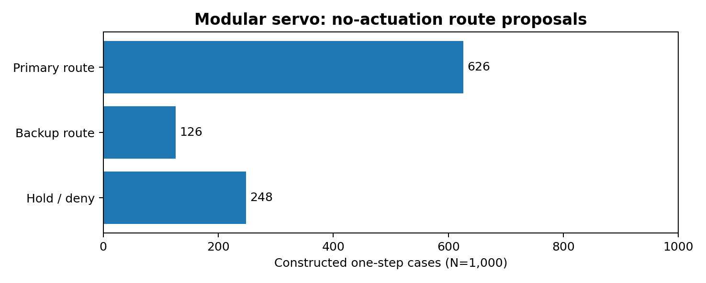

# A Robot Should Know When Its Bus Is Gone
## A Conservative Dual-Route, Fault-Isolation State Machine for Modular Servo Systems

**Working paper 0.1 — computational prototype, November 17, 2026**  
**OpenLine independent research — technical report, not peer reviewed**
**Terrynce Anson White — Independent Researcher, OpenLine**  
**Manuscript: CC BY 4.0. Executable code: Apache License 2.0. Version 1.0.**

### Abstract

Low-cost modular robotic arms commonly share serial-bus and power dependencies. A broken connector or local overcurrent can leave an otherwise functional robot unable to complete an authorized task. We implemented a minimal, dry-run fault-isolation and alternate-route proposal engine for six simulated servo joints. The engine represents primary/backup connectivity, measured-current threshold, observation age, explicit owner authorization, and STOP epochs, and generates proposed routes without contacting servos. In 1,000 deterministic generated cases, it satisfied 1,000/1,000 predefined safety invariants: no command was proposed without current authority, fresh observation, a viable route, and a joint below the simulated current limit. There were 126 proposed backup-route cases; 248 were held or denied. This is a bounded verification of software invariants. It does **not** prove the feasibility of the physical dual-ring topology, eFuse isolation timing, manipulator stability, task completion, or a novel recovery mechanism. It is a release-independent starter for controlled laboratory measurement against a strong conventional design.

### 1. Engineering problem and baseline

Hugging Face's LeRobot SO-101 documentation establishes the use of Feetech servo buses. Serial daisy-chaining, fault isolation, bus redundancy, and safe stopping are well-known engineering practices. The candidate is therefore evaluated as a proposed *low-cost implementation of a known resilience pattern*, not as the invention of redundant robot communications.

Argon's prior screening suggested that a dual-ring controller with electronic fuse isolation could preserve limited function after one cable or actuator fault. The old `evaluate_finalist2_shmc_sts3215` software reports 39/40 synthetic successes versus 10/40 for a modeled single chain. However, inspection shows those successes are assigned through fixed scenario conditionals rather than resulting from a simulated serial bus, power network, or dynamics solver. Those numerical advantages are **not a hardware performance measurement or a fair external comparison** and are excluded from this paper's primary results.

### 2. Actual executable deliverable

`src/modular_servo.py` implements `ServoController`, a pure Python fault/authority state machine. For each joint it receives a monotonically timed `ServoObservation` containing primary and backup route availability, current, and temperature. A request to `propose(joint, target, now, authorized, expected_epoch)` is refused if owner permission is absent, STOP is active, the epoch is stale, telemetry is absent/stale, or the target is outside the normalized interval. It holds if both routes are unavailable. Above the configured current or temperature threshold it isolates the joint until an explicitly authorized and externally inspected reset occurs.

When all guards pass, it selects the primary path or a backup path and returns `PROPOSED_NOT_SENT` with `actuation: NOT_IMPLEMENTED`. This output is **not a motor-control signal**, and the software does not open a serial port. The prototype deliberately makes no claim that rerouting a UART daisy chain is electrically or mechanically possible on existing SO-101 wiring without additional hardware. A faulted joint's exclusion also does not demonstrate that the remaining joints can safely execute a specific manipulator trajectory.

### 3. Source-executed results

The full 27-test portfolio suite includes 11 tests specifically targeting servo route selection, backup selection, no-route hold, current isolation, stale observation, explicit authorization, STOP/Resume epoch revocation, bad target, re-enabling only after owner/inspection, and monotonic timestamps. The tests pass in normal and optimized Python. Additional independent-of-test-runner deterministic trials generate 1,000 constructed observation/action situations under fixed seed 20261117. The key invariant was upheld 1,000/1,000 times: no proposed route occurs under unapproved authority, stale data, overcurrent, or missing both routes.

Observed branch totals from the simulator are 626 primary-route proposals, 126 backup-route proposals, and 248 holds or denials. There were 151 cases in which the primary route was unavailable but an otherwise eligible command could have proceeded. Of those, 126 had a viable modeled backup route, and 25 did not. The model's benefit is purely structural: a configured alternate route is available in cases where a primary-only route is not. No real bus availability or reconfiguration speed is measured.

### 4. Independent physical gates

A subsequent laboratory investigation would require wiring diagrams and isolation/protection design reviewed by a qualified electrical engineer, instrumented bus-voltage/current measurements, a deliberately protected short-fault fixture, live communication timing, and actual mechanical envelope checks. It must measure whether the backup wiring preserves communication without creating unsafe backfeeding, ground-fault coupling, duplicate addressing, or unexpected motion. A second requirement is to verify that reduced degrees of freedom preserve useful, safe tasks rather than simply letting motors respond.

Comparators must be both a competent conventional single-bus design with appropriate watchdog/fuse protection and a matched-budget redundant controller. Success is *more independently completed safe tasks per total cost under representative faults*. The candidate loses if it adds complexity or increases unsafe motion, or if matched conventional watchdog/restart/repair performs equally well. An automated simulator that merely issues more commands is not a win.

### 5. Relationship to OpenLine

The simulated planner separates proposed actions, current authorization, observed condition, and a STOP epoch. This resembles OpenLine's receiver-side authority ideas, but the standalone module has no connected receiver, cryptographic key custody, or actual servo enforcement. Transplanting the state machine into a robot should not grant it COMMIT authority; a physically independent receiver and safety system are still required. This is a proposed application boundary, not a verified deployed integration.

### 6. Limitations and disposition

**Prototype: software only; physical robot: HOLD.** Neither a six-servo manipulator nor a dual-ring electrical fixture was assembled. eFuse timing and temperature thresholds are assumed constants. Collision avoidance, force limiting, dynamics, precision, stability, EMC, clinical use, and human safety are not verified. The original estimated $34.20 additional controller BOM was not independently repriced and is not a supplier quotation. No firmware/driver integration was attempted. This document can be published as a limited technical report with full source and tests, but should not be described as experimentally demonstrated fault-tolerant hardware.

### Sources and reproduction

- Hugging Face, LeRobot SO-101 assembly and motor-bus documentation: https://huggingface.co/docs/lerobot/so101 and https://huggingface.co/docs/lerobot/main/en/integrate_hardware
- Original Argon portfolio, November 17, 2026, `cib_001_product_core.py` (`evaluate_finalist2_shmc_sts3215`), treated as prior constructed-model work.
- Standalone testable source: `src/modular_servo.py`, `tests/test_prototypes.py`, `run_portfolio.py`, `results/constructed_scenario_receipt.json`.

Run `python3 -m unittest discover -s tests -v` and `python3 run_portfolio.py` from the bundle root. No physical I/O occurs.
